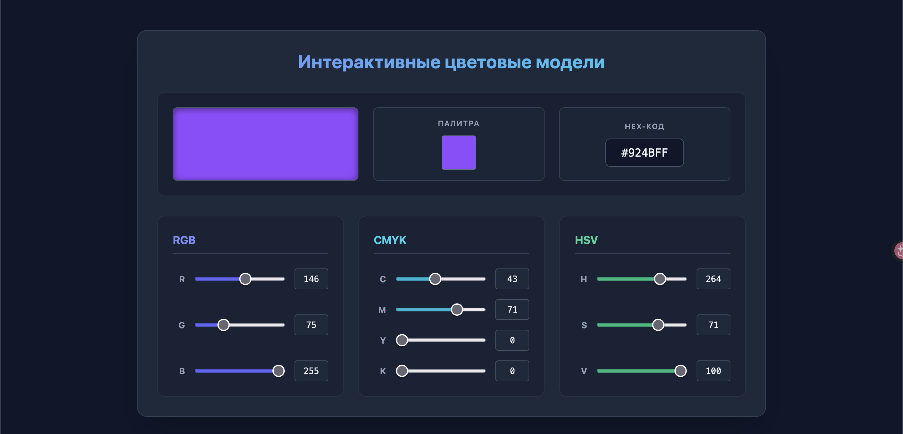

# ОТЧЕТ по Лабораторной работе №1

**Тема:** «Исследование цветовых моделей (RGB, CMYK, HSV) и программная реализация интерактивного преобразования»  
**Дисциплина:** Компьютерная графика  

**Выполнил:** Дикан Данила Александрович
**Группа:** 4  

### 1. Цель работы

1. Изучить теоретические основы и математические модели представления цвета в компьютерной графике: аддитивную (RGB), субтрактивную (CMYK) и перцептивную (HSV).
2. Создать  приложение/веб-приложение, позволяющее пользователю   выбирать, а затем интерактивно менять цвет,  показывая при этом его  составляющие в трех моделях одновременно.

### 2. Теоретические сведения

Цветовая модель — абстрактная математическая модель описания представления цветов в виде кортежей чисел.

* **RGB (Red, Green, Blue)** — аддитивная цветовая модель. Используется в устройствах вывода света (мониторы). Цвета образуются путем добавления излучения к черному экрану. Диапазон каждого канала: $[0, 255]$. Смешение всех максимумов дает белый цвет.
* **CMYK (Cyan, Magenta, Yellow, Key/Black)** — субтрактивная модель. Применяется в полиграфии. Краска на белой бумаге поглощает (вычитает) лучи света. Диапазон каналов: $[0, 100]\%$. Дополнительный черный канал ($K$) введен из-за неидеальности красителей и для предотвращения чрезмерного намокания бумаги.
* **HSV (Hue, Saturation, Value)** — модель, приближенная к человеческому восприятию. 
  * $H$ (Цветовой тон) — угол на цветовом круге: $[0, 360^\circ]$;
  * $S$ (Насыщенность) — чистота цвета: $[0, 100]\%$;
  * $V$ (Яркость) — интенсивность освещения: $[0, 100]\%$.

**Математические преобразования:**
Для оптимизации вычислений использована топология «Хаб», то есть базовым узлом является модель RGB. Перевод между любыми моделями $A$ и $B$ осуществляется через промежуточный шаг: $A \rightarrow \text{RGB} \rightarrow B$.

*Формулы RGB $\rightarrow$ CMYK:*
$$K = 1 - \max(R', G', B'), \quad \text{где } R', G', B' \in [0, 1]$$
$$C = \frac{1 - R' - K}{1 - K}, \quad M = \frac{1 - G' - K}{1 - K}, \quad Y = \frac{1 - B' - K}{1 - K}$$

### 3. Архитектура и реализация приложения

1. **Backend (Python 3.9+ / Flask):**
   * `lab/models.py` — описание моделей данных с помощью `@dataclass` (`RGB`, `CMYK`, `HSV`). В методе `__post_init__` реализована валидация диапазонов входных данных.
   * `lab/errors.py` — иерархия собственных исключений на базе `ColorError`.
   * `lab/processing.py` — модуль чистых математических функций перевода (`rgb_to_cmyk`, `cmyk_to_rgb`, `rgb_to_hsv`, `hsv_to_rgb`, `hex_to_rgb`, `rgb_to_hex`).
   * `lab/main.py` — REST API контроллер, обрабатывающий эндпоинты `/` (выдача интерфейса) и `/api/convert` (POST-запрос на пересчет координат).
2. **Фронтенд (HTML5 / Tailwind CSS / Vanilla JS):**
   * Выполнен в виде отзывчивого веб-интерфейса.
   * Связь с бэкендом осуществляется через асинхронные запросы `fetch` без блокировки основного потока интерфейса (Event Loop).
   * Реализована защита от циклической рекурсии обновлений: при изменении параметров одной модели интерфейс программно синхронизирует только две зависимые, исключая источник вызова.

### 4. Результаты работы программы

В ходе тестирования была проверена работа конвертации на граничных и произвольных значениях:

1. **Граничные значения:**
   * Черный цвет (`#000000`): RGB (0, 0, 0) $\rightarrow$ CMYK (0, 0, 0, 100) $\rightarrow$ HSV (0, 0, 0).
   * Белый цвет (`#FFFFFF`): RGB (255, 255, 255) $\rightarrow$ CMYK (0, 0, 0, 0) $\rightarrow$ HSV (0, 0, 100).
2. **Интерактивная работа:**
   * При перемещении ползунка в модели RGB синхронно изменяются значения в CMYK, HSV, превью цвета и HEX-код.

### 5. Выводы

В результате выполнения лабораторной работы:

1. Были изучены принципы функционирования аддитивных (RGB), субтрактивных (CMYK) и перцептивных (HSV) цветовых пространств, а также специфика их применения в компьютерной графике и полиграфии.
2. Спроектировано и реализовано интерактивное веб-приложение с микросервисной архитектурой на базе микрофреймворка Flask.
3. Реализована строгая валидация предметной области с помощью возможностей Python Dataclasses и кастомных исключений, что гарантирует отказоустойчивость приложения при некорректных действиях пользователя.
4. Достигнута синхронизация данных в реальном времени с нулевой задержкой за счет локального REST API взаимодействия.
